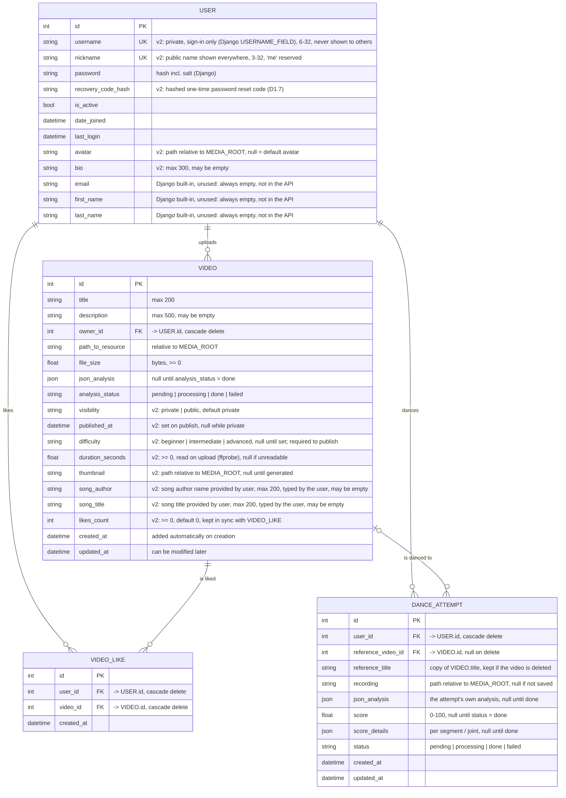

# Data model v2

Changes from [v1](v1.md): user profile fields, video visibility (public videos form the library),
likes, dance attempts with scores.

## The library

The library has no table of its own: it is `VIDEO WHERE visibility = 'public'`, served by
`/api/library/`. Everything it shows or filters by lives on VIDEO (`published_at`, `difficulty`,
`duration_seconds`, `likes_count`, `thumbnail`) or comes from VIDEO_LIKE (`liked_by_me`).
A separate table would only be needed for curated content (featured lists, collections), which is
not planned.

## Rules

| Rule                                                                                                    | Where |
|---------------------------------------------------------------------------------------------------------|---|
| `username` is private: only the user themself sees it (`CurrentUser`); everything public shows `nickname` | serializers |
| `nickname` is unique and not `me` (clashes with `/api/users/me/`)                                       | unique constraint + validator |
| `visibility` is `private` or `public`                                                                   | check constraint |
| `published_at` is set if and only if `visibility = 'public'`                                            | check constraint |
| only a video with `analysis_status = done` and a `difficulty` can be published                          | `services.update_video()` (PATCH `visibility`) |
| `difficulty` is one of the three values or null                                                         | check constraint |
| `duration_seconds >= 0`, `likes_count >= 0`                                                             | check constraints |
| one like per (user, video)                                                                              | unique constraint on VIDEO_LIKE |
| only public videos can be liked; unpublishing keeps the likes                                           | services |
| `likes_count` changes only together with a VIDEO_LIKE insert/delete, with `F('likes_count') ± 1`        | services |
| `score` between 0 and 100                                                                               | check constraint |
| `reference_video` is public or owned by the dancer when the attempt is created                          | services |
| deleting a VIDEO keeps the attempts danced to it (`reference_video_id` = null, `reference_title` stays) | `on_delete=SET_NULL` |
| deleting a USER deletes their videos, likes and attempts; files via `post_delete` signals               | CASCADE + signals ([cleanups.md](../../cleanups.md)) |

## Indexes

- VIDEO `(visibility, published_at)`: the library list, newest first.
- VIDEO `(visibility, likes_count)`: the library sorted by likes.
- VIDEO `difficulty`: the library filter.
- DANCE_ATTEMPT `(user_id, created_at)`: a user's history, newest first.
- DANCE_ATTEMPT `(user_id, reference_video_id)`: history and best score for one video.

## Decisions

- **`username` signs in, `nickname` is public.** Django's `AbstractUser` already signs in with `username`, so it
  keeps that meaning and needs no custom manager; the public name is a separate `nickname`. No email sign-in
  (no SMTP), so password reset uses a recovery code (`docs/api-decisions.md` D1.1, D1.7).

- **Attempt recordings are not VIDEO rows.** DANCE_ATTEMPT stores its own file, so recordings never
  show up in `/api/videos/`, can't be published and need no `kind` field on VIDEO.
- **`published_at` instead of a "visibility changed at" field.** The library sorts by it. A full
  history of visibility changes would need a log table, which no feature needs yet.
- **`likes_count` is stored, not counted per request**, so the library can sort by likes cheaply.

## Open questions

- Is a recording uploaded after dancing, or is the camera analysed live in the browser? If live,
  `recording` stays null and the frontend sends the analysis (or frames) instead of a file.
- Library filters beyond difficulty: add `dance_style` (fixed list) and `bpm` (from audio analysis)?
- Can a user like their own video?
