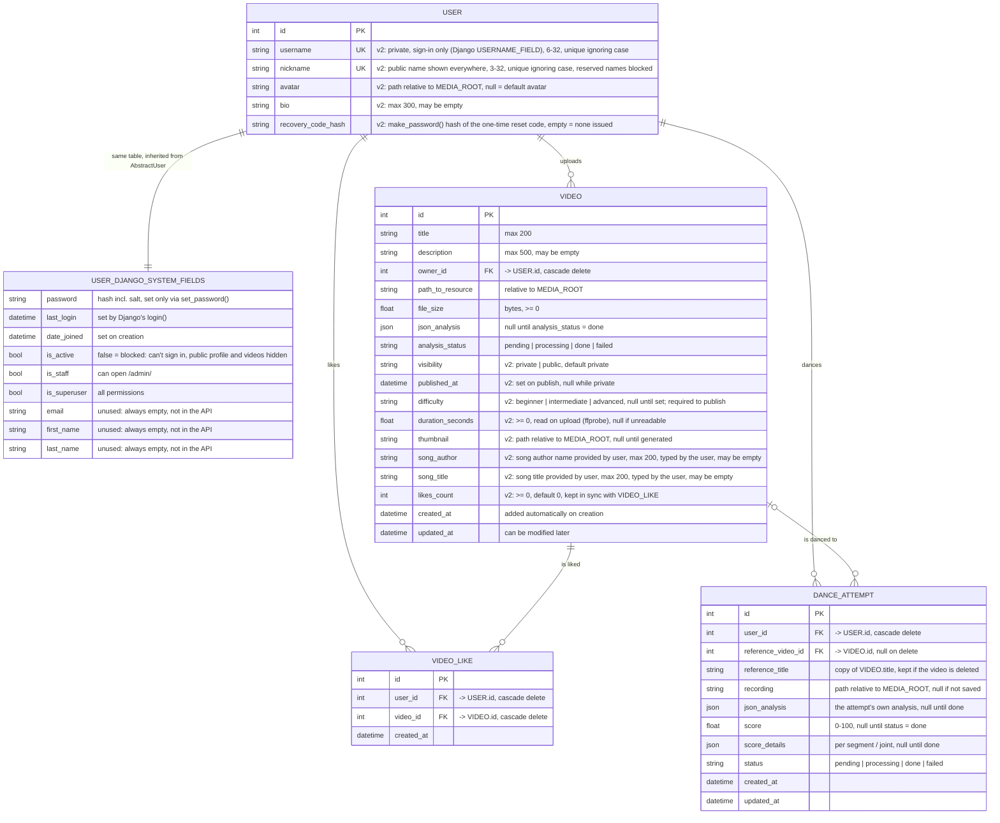

# Data model v2

Changes from [v1](v1.md): user profile fields, video visibility (public videos form the library),
likes, dance attempts with scores.

## USER fields

`accounts.User` subclasses Django's `AbstractUser`. In the diagram, USER holds our fields and
USER_DJANGO_SYSTEM_FIELDS the inherited ones; both are **one table** (`accounts_user`), drawn apart only for readability.
The model (`accounts/models.py`) declares only what differs from Django: `username` (overridden: shorter,
case-insensitive) and the v2 fields. The inherited columns exist since `accounts/0001_initial`.

### Our fields

| Field | Rules | Where it's used |
|---|---|---|
| `username` | 6-32 chars, letters, digits and `@ . + - _`; unique ignoring case | signing in only; returned only to its owner (`CurrentUser`) |
| `nickname` | 3-32 chars, letters, digits and `. _ -` (it's in URLs); unique ignoring case; not a reserved name | everywhere public: profile URL `/api/users/{nickname}/`, video authors, `?author=` |
| `avatar` | JPEG / PNG, max 5 MB; null = default avatar | `avatar_url` in the API |
| `bio` | max 300, may be empty | profile |
| `recovery_code_hash` | hash only, never the code; empty = no code issued yet | password reset (D1.7) |

### Django system fields (not our functionality)

| Field | From | What it is | Do we use it? |
|---|---|---|---|
| `password` | `AbstractBaseUser` | `pbkdf2_sha256$<iterations>$<salt>$<hash>`, never the raw password | yes, via `set_password()` / `check_password()` only |
| `last_login` | `AbstractBaseUser` | set by Django's `login()` | no (admin info) |
| `date_joined` | `AbstractUser` | `timezone.now` on creation | no (admin info) |
| `is_active` | `AbstractUser` | `false` = blocked account (see Rules) | yes: set only in the admin |
| `is_staff`, `is_superuser`, `groups`, `user_permissions` | `AbstractUser`, `PermissionsMixin` | admin access and permissions | admin only |
| `email`, `first_name`, `last_name` | `AbstractUser` | unused, always empty | no: kept so Django's manager, admin and forms work unchanged |

### Recovery code

- Generated in `accounts/services.py` with `secrets` (never `random`): 16 characters from
  `ABCDEFGHJKMNPQRSTUVWXYZ23456789` (no `0/O`, `1/I/L`), shown as `XXXX-XXXX-XXXX-XXXX`, ~79 bits.
- Stored with Django's `make_password()` (same hasher as passwords), checked with `check_password()`.
  No hash function of our own.
- Normalized before hashing and checking: dashes and spaces removed, upper case, so the user may type it either way.
- Shown once: in the register response, after a reset (the old code is used up) and from `/api/users/me/recovery-code/`.

### Reserved nicknames

`me` clashes with `/api/users/me/`. The others prevent impersonation:
`me, admin, administrator, root, system, staff, support, moderator, mod, help, api, null, undefined, onbeat, dancingbuddy`
(`RESERVED_NICKNAMES` in `accounts/validators.py`, checked ignoring case).

## The library

The library has no table of its own: it is `VIDEO WHERE visibility = 'public'`, served by
`/api/library/`. Everything it shows or filters by lives on VIDEO (`published_at`, `difficulty`,
`duration_seconds`, `likes_count`, `thumbnail`) or comes from VIDEO_LIKE (`liked_by_me`).
A separate table would only be needed for curated content (featured lists, collections), which is
not planned.

What a user sees there (`VideoQuerySet.visible_to(user)` in `videos/models.py`, DAN-141): public videos
whose owner is active, **plus all their own videos**, private ones included (`/api/library/?scope=all`;
`scope=mine` = only their own). See `docs/api-decisions.md` D0.1.
A visitor who isn't logged in sees the public videos only and can play them; liking and dancing need an
account (D7.6).

The liked list (`/api/library/liked/`) has no table either: it is the same set of videos, kept only
where a VIDEO_LIKE row exists for the user, newest like first (`VIDEO_LIKE.created_at`). A liked video
that its owner unpublished drops out of the list, but the VIDEO_LIKE row stays, so it comes back if the
video is published again (D5.2).

`times_played` and `best_score` on a library card are not columns: both are computed per request from
DANCE_ATTEMPT (`COUNT` of the attempts on the video; the user's own highest `score`), D4.3.

## Rules

| Rule                                                                                                    | Where |
|---------------------------------------------------------------------------------------------------------|---|
| `username` is private: only the user themself sees it (`CurrentUser`); everything public shows `nickname` | serializers |
| `username` and `nickname` are unique ignoring letter case (`Ana` = `ana`); signing in ignores case too  | `UniqueConstraint(Lower(...))` + `UserManager.get_by_natural_key` |
| `nickname` is not a reserved name (`me`, `admin`, ..., see USER fields)                                 | validator |
| the recovery code is stored only as a hash                                                              | `accounts/services.py` |
| an inactive user (`is_active = false`) can't sign in; their public profile is 404 and their videos leave the library | Django's `ModelBackend` + queries (`owner__is_active=True`) |
| `visibility` is `private` or `public`                                                                   | check constraint |
| `published_at` is set if and only if `visibility = 'public'`                                            | check constraint |
| only a video with `analysis_status = done` and a `difficulty` can be published                          | `services.update_video()` (PATCH `visibility`) |
| `difficulty` is one of the three values or null                                                         | check constraint |
| `duration_seconds >= 0`, `likes_count >= 0`                                                             | check constraints |
| one like per (user, video)                                                                              | unique constraint on VIDEO_LIKE |
| only public videos can be liked; unpublishing keeps the likes                                           | the library view checks visibility (DAN-141); nothing deletes likes except CASCADE |
| a user can like their own video                                                                         | no rule against it (`docs/api-decisions.md` D5.2) |
| `likes_count` changes only together with a VIDEO_LIKE insert/delete, with `F('likes_count') ± 1`        | `likes.services` (`like_video` / `unlike_video`) |
| `score` between 0 and 100                                                                               | check constraint |
| `reference_video` is public or owned by the dancer when the attempt is created                          | services |
| deleting a VIDEO keeps the attempts danced to it (`reference_video_id` = null, `reference_title` stays) | `on_delete=SET_NULL` |
| deleting a USER deletes their videos, likes and attempts; files via `post_delete` signals               | CASCADE + signals ([cleanups.md](../../cleanups.md)) |

## Indexes

- VIDEO `(visibility, published_at)`: the library list, newest first.
- VIDEO `(visibility, likes_count)`: the library sorted by likes.
- VIDEO `difficulty`: the library filter.
- VIDEO_LIKE `(user_id, created_at)`: the videos a user liked, newest first.
- DANCE_ATTEMPT `(user_id, created_at)`: a user's history, newest first.
- DANCE_ATTEMPT `(user_id, reference_video_id)`: history and best score for one video.

## Decisions

- **`username` signs in, `nickname` is public.** Django's `AbstractUser` already signs in with `username`, so it
  keeps that meaning and Django's admin and forms work as they are; the public name is a separate `nickname`.
  The only manager change is a case-insensitive sign-in lookup.
- **Blocking, not deleting, is `is_active = false`.** Set by an admin (abuse, or a user who lost both password and
  recovery code). Data stays; `DELETE /api/users/me/` is still a real delete (D2.3). No email sign-in
  (no SMTP), so password reset uses a recovery code (`docs/api-decisions.md` D1.1, D1.7).

- **Attempt recordings are not VIDEO rows.** DANCE_ATTEMPT stores its own file, so recordings never
  show up in `/api/videos/`, can't be published and need no `kind` field on VIDEO.
- **`published_at` instead of a "visibility changed at" field.** The library sorts by it. A full
  history of visibility changes would need a log table, which no feature needs yet.
- **`likes_count` is stored, not counted per request**, so the library can sort by likes cheaply.
  Known drift: deleting a USER CASCADE-deletes their likes without decrementing `likes_count` on the videos they
  liked (the same when a like is deleted in the Django admin). A future worker will re-sync `likes_count` from
  `COUNT(VIDEO_LIKE)`.
- **VIDEO_LIKE lives in its own Django app, `likes`** (`likes.models.VideoLike`), like DANCE_ATTEMPT in
  `dance_attempts`. `likes` imports from `videos`, never the other way round.

## Open questions

- Is a recording uploaded after dancing, or is the camera analysed live in the browser? If live,
  `recording` stays null and the frontend sends the analysis (or frames) instead of a file.
- Library filters beyond difficulty: add `dance_style` (fixed list) and `bpm` (from audio analysis)?
- ~~Can a user like their own video?~~ Yes (`docs/api-decisions.md` D5.2).
