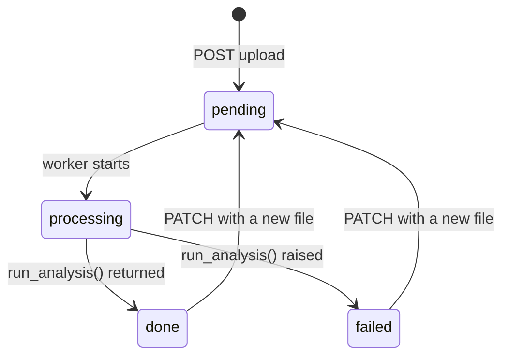
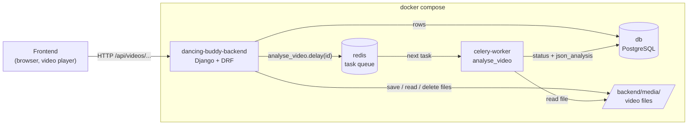
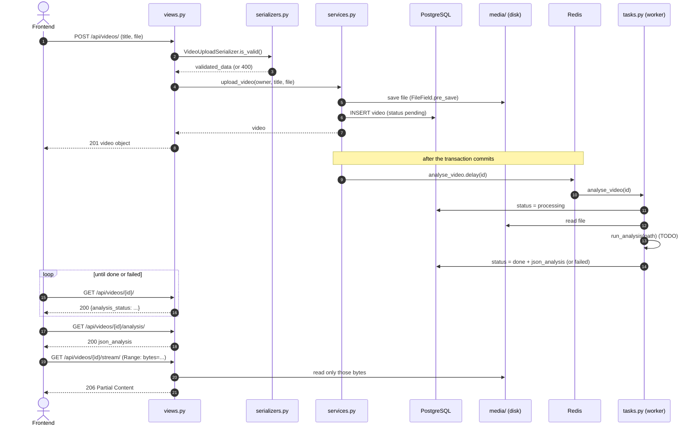

# Videos API

Upload dance videos, stream them back to the player, and get their pose analysis.
Django REST Framework, PostgreSQL, Celery + Redis for the analysis.

- [Endpoints](#endpoints)
- [Architecture](#architecture)
- [Data flow](#data-flow)

---

## Endpoints

Routes are registered in `zpi_app/urls.py` (`router.register('videos', VideoViewSet)`).
`{id}` is a number (`lookup_value_regex = r'\d+'`).

### Authentication

Every endpoint requires a logged-in user (`IsAuthenticated` in `settings/base.py`).

| How | Where | Notes |
|---|---|---|
| Session cookie | all environments | Log in at `/admin/` or `/api-auth/login/`. Works for `<video src=...>`. Writes (POST/PATCH/DELETE) need the CSRF token. |
| Basic Auth | **dev only** (`settings/dev.py`) | For Postman / curl: `curl -u user:pass ...`. No CSRF needed. |

Not logged in → **403** on every endpoint.

**Owner-only:** a user only ever sees their own videos. Another user's video gives **404**
(not 403), so the API doesn't reveal that the id exists.

### Summary

| Method | URL | What | Success | Errors |
|---|---|---|---|---|
| `GET` | `/api/videos/` | list your videos, newest first | 200 | 403 |
| `POST` | `/api/videos/` | upload a video, queues the analysis | 201 | 400, 403 |
| `GET` | `/api/videos/{id}/` | one video | 200 | 403, 404 |
| `PATCH` | `/api/videos/{id}/` | rename, or replace the file (re-runs the analysis) | 200 | 400, 403, 404 |
| `DELETE` | `/api/videos/{id}/` | delete the row and the file | 204 | 403, 404 |
| `GET` | `/api/videos/{id}/stream/` | the video file, with Range support | 200, 206 | 403, 404, 416 |
| `GET` | `/api/videos/{id}/analysis/` | the whole analysis JSON | 200 | 403, 404, 409 |
| `GET` | `/api/videos/{id}/thumbnail/` | not implemented yet | | 501 |

`PUT` (full replace) is not supported → 405. `POST /analysis/` → 405: the analysis only
starts on upload or when a new file is sent with PATCH.

### The video object

Returned by list, retrieve, upload and PATCH (`VideoSerializer`):

```json
{
  "id": 42,
  "title": "Salsa basic step",
  "description": "Slow version",
  "file_size": 48213504.0,
  "analysis_status": "pending",
  "created_at": "2026-11-03T12:00:00Z"
}
```

| Field | Notes |
|---|---|
| `file_size` | bytes; read-only, computed on upload |
| `analysis_status` | read-only: `pending` → `processing` → `done` or `failed` (see [Analysis status](#analysis-status)) |

Not in the object: `owner` (always you), the file path (use `/stream/`), `json_analysis` (use `/analysis/`, it can be large).

### `GET /api/videos/`

Your videos, newest first. An empty list is `[]` with 200, not 404.

### `POST /api/videos/`

`multipart/form-data`:

| Field | Required | Rules |
|---|---|---|
| `title` | yes | max 200 characters |
| `description` | no | max 500 characters, default `""` |
| `file` | yes | extension `mp4`, `mov` or `webm`; max 500 MB |

→ **201** with the video object (`analysis_status: "pending"`). The file is stored as
`media/videos/user_<owner id>/<random>.<ext>` and the analysis is queued.
An `owner` field in the form is ignored. → **400** with the field errors, e.g.
`{"file": ["Allowed file types: mp4, mov, webm."]}`.

### `GET /api/videos/{id}/`

→ **200** with the video object. The frontend checks `analysis_status` here before asking for `/analysis/`.

### `PATCH /api/videos/{id}/`

JSON or `multipart/form-data`; send only what changes:

| Field | Effect |
|---|---|
| `title`, `description` | renamed; the analysis is kept |
| `file` (multipart) | same rules as upload. Replaces the file, clears `json_analysis`, sets `analysis_status` back to `pending` and queues a new analysis. The old file is deleted. |

`file_size` and `analysis_status` in the body are ignored. `{}` changes nothing. → **200** with the updated object.

### `DELETE /api/videos/{id}/`

→ **204**, no body. The row is deleted, then the file (once the delete is committed).

### `GET /api/videos/{id}/stream/`

The video file for `<video src="/api/videos/42/stream/">`. The player seeks by sending
`Range` headers (bytes, not seconds; it works out the offsets from the file's index):

| Request | Response |
|---|---|
| no `Range` | **200**, whole file, `Accept-Ranges: bytes` |
| `Range: bytes=0-99` / `bytes=100-` / `bytes=-100` | **206**, only those bytes, `Content-Range: bytes START-END/SIZE` |
| malformed or several ranges | ignored → **200** with the whole file |
| range starts past the end | **416**, `Content-Range: bytes */SIZE` |

`?download=1` → `Content-Disposition: attachment; filename="<title>.<ext>"` (saved instead of played).

```bash
curl -u user:pass -H "Range: bytes=0-99" -i http://localhost:8000/api/videos/42/stream/
```

### `GET /api/videos/{id}/analysis/`

→ **200** with `json_analysis` exactly as stored, once `analysis_status` is `done`.
→ **409** `{"detail": "Video is not analysed yet."}` while it's `pending`, `processing` or `failed`.

The JSON format isn't decided yet (list of `Frame` dicts vs DAN-35's `ChoreoData`).

### Analysis status



---

## Architecture

### Layers

Each layer has one job. The rule that matters most: **every write goes through `services.py`**.

| Layer | File | Does | Never does |
|---|---|---|---|
| View | `views.py` | HTTP only: find the video (always `owner=request.user`, 404 otherwise), validate with a serializer, call a service, return the response + status code | validate field values itself, write to the DB |
| Serializer | `serializers.py` | whitelist fields, convert types, validate the request; object → JSON | read from the DB, save (no `serializer.save()`) |
| Service | `services.py` | every write and side effect: DB rows, files, queueing the analysis. Plain functions, keyword-only args | know about `request` / HTTP |
| Task | `tasks.py` | background work in the Celery worker; writes through services, like views do | run inside a web request |
| Model | `models.py` | data, DB constraints, small `@property` facts (`is_analysed`, ...) | know about HTTP or Celery |

### Modules

| File | What's in it                                                                                                                                                                                                                                          |
|---|-------------------------------------------------------------------------------------------------------------------------------------------------------------------------------------------------------------------------------------------------------|
| `models.py` | `Video` (the VIDEO table from `db/diagram/v2.md`), `AnalysisStatus` choices, `video_upload_path()` (where files are stored), constraints: `file_size >= 0`, status is one of the four values                                                          |
| `serializers.py` | `VideoSerializer` (output + PATCH; a `ModelSerializer`, plus a write-only `file`), `VideoUploadSerializer` (POST; a plain `Serializer`, because the request's `file` isn't a model field), file checks `validate_filename()` / `validate_file_size()` |
| `views.py` | `VideoViewSet`: one method per endpoint (`list`, `create`, `retrieve`, `partial_update`, `destroy`, and the `stream`, `thumbnail`, `analysis` actions)                                                                                                |
| `services.py` | `upload_video`, `update_video`, `delete_video`, `start_analysis` (queues the task), `set_analysis_result` (status/result written by the task)                                                                                                         |
| `tasks.py` | `analyse_video` (Celery task), `run_analysis()`: **TODO**, the entry point of the real analysis                                                                                                                                                       |
| `streaming.py` | `range_file_response()` (200 / 206 / 416), `parse_range_header()` (pure, unit-tested), `read_chunks()` (64 KB at a time)                                                                                                                              |
| `admin.py` | `Video` in the Django admin (`/admin/`), `json_analysis` read-only                                                                                                                                                                                    |
| `tests.py` | API tests, task tests, Range parser tests                                                                                                                                                                                                             |

Outside the app:

| File | Role |
|---|---|
| `zpi_app/urls.py` | registers `VideoViewSet` on the router under `/api/videos/` |
| `zpi_app/celery.py` | the Celery app; reads `CELERY_*` settings, finds `tasks.py` |
| `zpi_app/__init__.py` | loads the Celery app when Django starts |
| `zpi_app/settings/base.py` | REST framework defaults, media folder, `CELERY_BROKER_URL` |
| `zpi_app/settings/test.py` | `CELERY_TASK_ALWAYS_EAGER`: tests run tasks inline, no Redis needed |
| `docker-compose.yml` | `db` (Postgres), `redis`, `dancing-buddy-backend` (Django), `celery-worker` |

### Decisions worth knowing

- **Files are deleted only after the DB transaction commits** (`transaction.on_commit`), so a
  rolled-back delete never loses the file.
- **The analysis is queued after commit too**, so the worker never looks for a row that isn't saved yet.
  If Redis is down, the upload still succeeds (`robust=True`) and the video stays `pending`.
- **A stale analysis can't overwrite a new file**: the task writes with
  `UPDATE ... WHERE id = .. AND path_to_resource = <the file it analysed>`.
- **`json_analysis` is never loaded for the list** (`.defer('json_analysis')`); it can be large.
- Known issues and their planned fixes are in [`../cleanups.md`](../cleanups.md).

---

## Data flow

### Containers



Django and the worker never talk to each other directly: Redis carries only the task
message (`analyse_video(42)`), and the worker writes the result straight into Postgres.

### Upload → analysis → playback



### Inside one request (upload)

```
router → VideoViewSet.create()
       → VideoUploadSerializer(data=request.data).is_valid(raise_exception=True)
             → CharField / FileField checks → validate_file() → validate_filename(), validate_file_size()
             → invalid: ValidationError → DRF exception handler → 400
       → services.upload_video(owner=request.user, **validated_data)
             → Video.objects.create() → FileField.pre_save() → video_upload_path() → storage.save()
             → INSERT
             → transaction.on_commit(start_analysis) → analyse_video.delay(video.pk)
       → Response(VideoSerializer(video).data, status=201)
```
